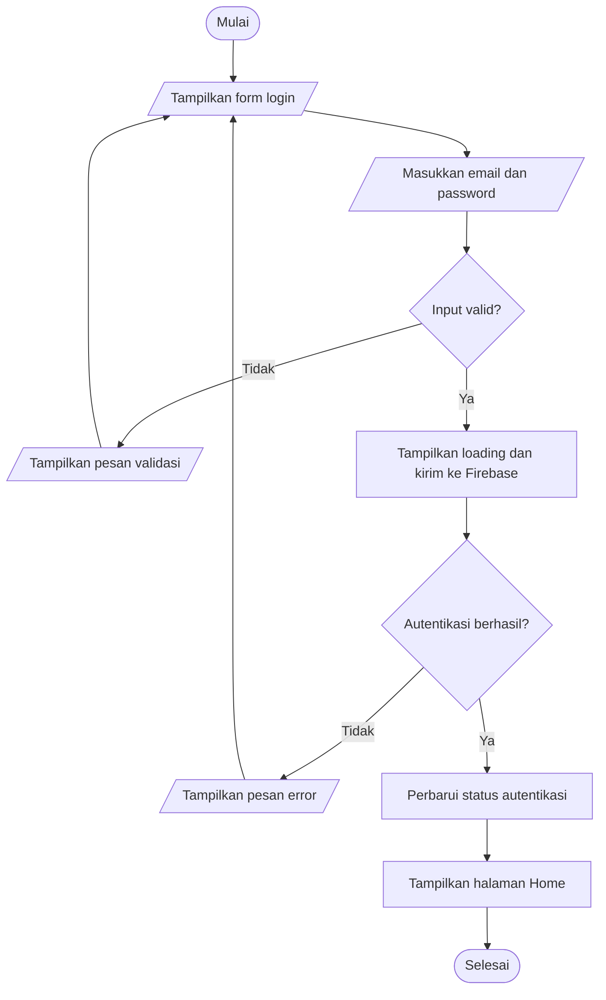
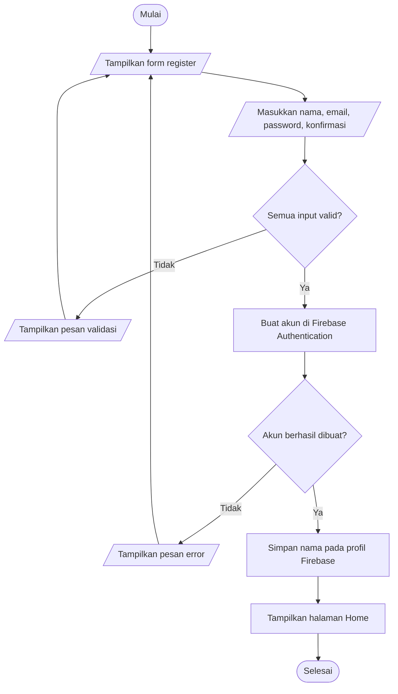
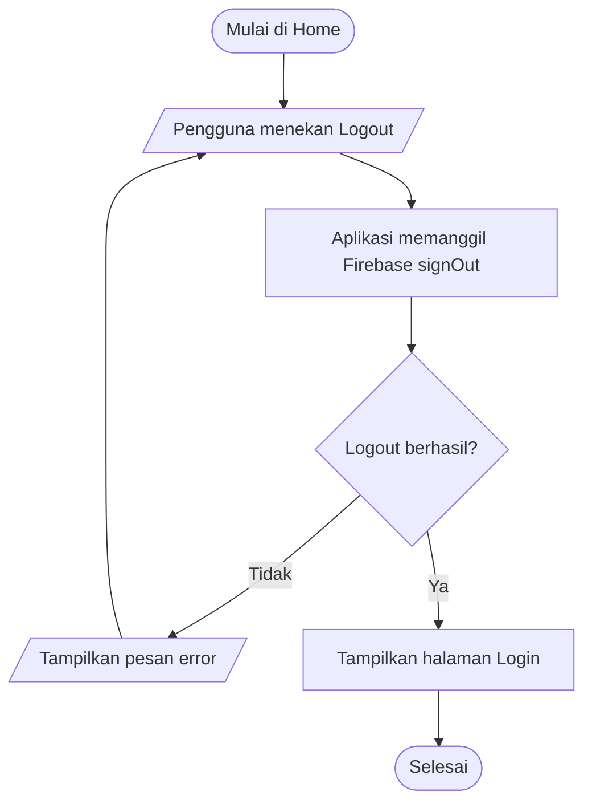

# Algoritma dan Flowchart Aplikasi Form Login Flutter

## Judul

**Aplikasi Form Login Flutter dengan Firebase Authentication**

## Tujuan

Menerapkan autentikasi email dan password pada aplikasi Android. Pengguna
dapat mendaftar, login, mempertahankan sesi saat aplikasi dibuka kembali,
melihat identitas akun, dan logout.

## Algoritma login

1. Mulai dan tampilkan form login.
2. Pengguna memasukkan email dan password.
3. Validasi bahwa kedua kolom terisi dan format email benar.
4. Jika tidak valid, tampilkan pesan validasi dan kembali ke form.
5. Tampilkan indikator loading dan kirim kredensial ke Firebase
   Authentication.
6. Jika Firebase menolak kredensial atau koneksi gagal, tampilkan pesan
   berbahasa Indonesia dan kembali ke form.
7. Jika berhasil, Firebase memperbarui status pengguna.
8. Auth state mengarahkan pengguna ke Home.
9. Selesai.

## Flowchart login

## Algoritma register

1. Mulai dan tampilkan form register.
2. Pengguna memasukkan nama lengkap, email, password, dan konfirmasi password.
3. Validasi kolom wajib, format email, panjang password minimal 6 karakter,
   serta kesamaan password dan konfirmasi.
4. Jika validasi gagal, tampilkan pesan pada kolom terkait.
5. Tampilkan loading dan buat akun dengan Firebase Authentication.
6. Simpan nama sebagai display name akun.
7. Jika Firebase gagal (misalnya email sudah digunakan), tampilkan pesan
   kesalahan.
8. Jika berhasil, Firebase membuat sesi login; tampilkan pesan berhasil dan
   arahkan pengguna ke Home.
9. Selesai.

## Flowchart register

## Algoritma logout

1. Mulai dari halaman Home.
2. Pengguna menekan tombol Logout.
3. Aplikasi meminta Firebase Authentication mengakhiri sesi.
4. Firebase mengubah status pengguna menjadi belum login.
5. Auth state menampilkan halaman Login.
6. Selesai.

## Flowchart logout

## Simbol flowchart

| Simbol | Arti | Contoh pada flowchart |
|---|---|---|
| Oval | Mulai atau selesai | Mulai, Selesai |
| Persegi panjang | Proses | Kirim kredensial ke Firebase |
| Jajar genjang | Input atau output | Masukkan email, tampilkan pesan |
| Belah ketupat | Keputusan dengan cabang | Input valid? |
| Panah | Arah urutan proses | Menghubungkan setiap langkah |

## Cara kerja Firebase Authentication

Firebase Authentication menerima email dan password melalui SDK resmi
FlutterFire. Firebase memvalidasi kredensial dan mengelola sesi pengguna.
Aplikasi mendengarkan `userChanges()` untuk memilih halaman Login jika tidak
ada pengguna atau Home jika sesi aktif. Firebase juga menyimpan sesi agar
status login tetap ada setelah aplikasi dimulai ulang. Password tidak
disimpan atau dibandingkan di dalam kode aplikasi. Provider Email/Password
harus diaktifkan di Firebase Console.

## Kesimpulan

Aplikasi memisahkan antarmuka, layanan autentikasi, dan alur sesi sehingga
mudah dipelajari dan dikembangkan. Validasi form memberi umpan balik sebelum
permintaan dikirim, sedangkan Firebase Authentication menangani pembuatan
akun, login, sesi, dan logout.
